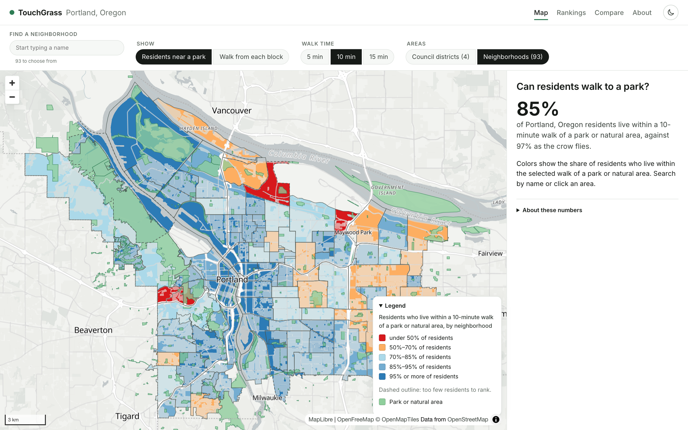
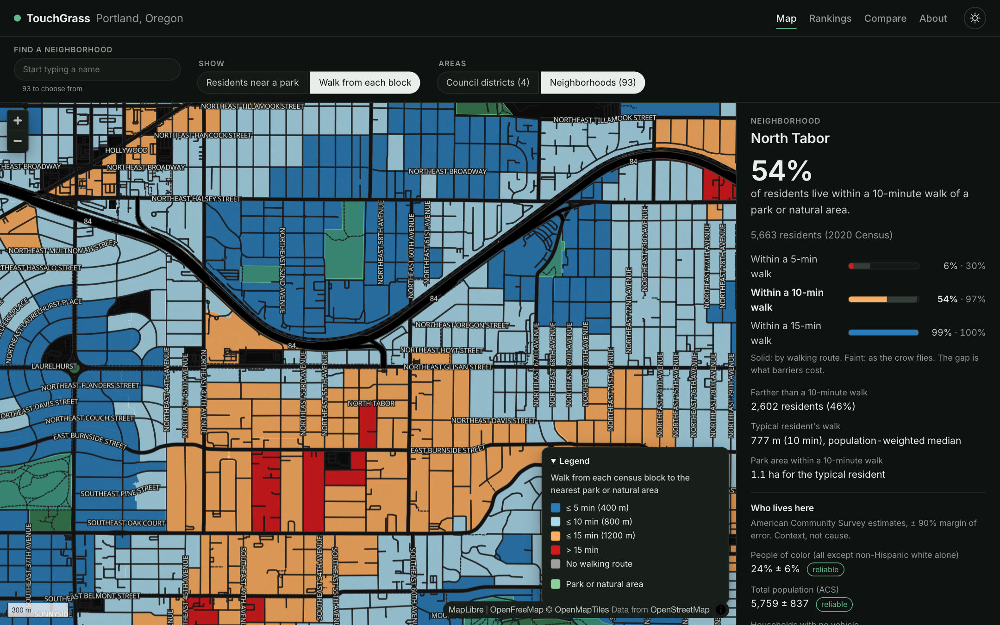
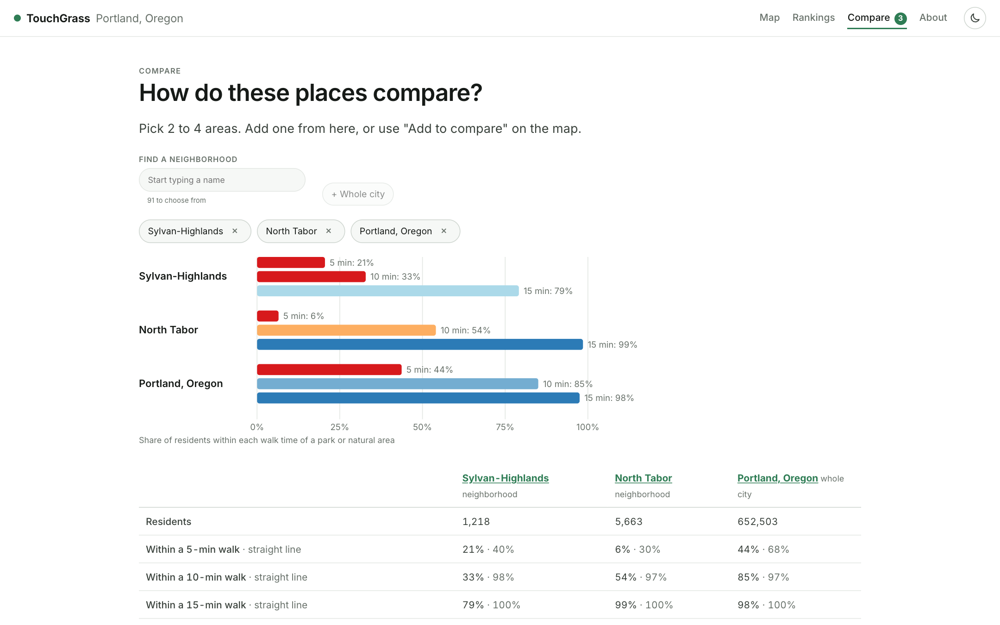
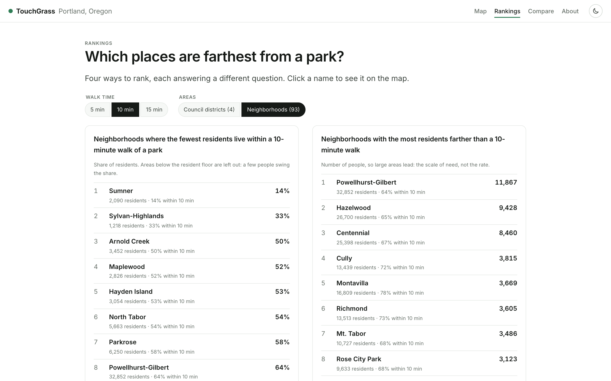
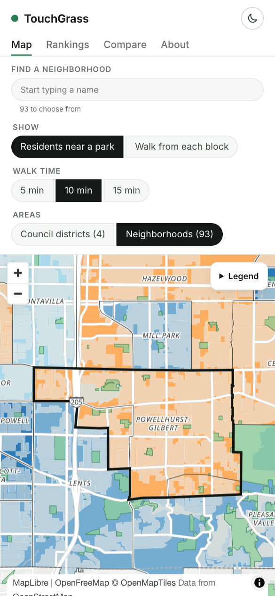

# TouchGrass

**How far is nature, really?** TouchGrass measures how many residents can *walk* to a park or natural area along real streets and paths, not as the crow flies, neighborhood by neighborhood and block by block. It starts with Portland, Oregon, and is built so another city is a configuration file, not a rewrite.

[](https://github.com/luangia/touch-grass/actions/workflows/ci.yml)

**Live:** [luangia.github.io/touch-grass](https://luangia.github.io/touch-grass/). Free hosting: the first visit after a quiet spell can take up to a minute while the server wakes.



## What it found (Portland, 2020 Census, OpenStreetMap 1 Nov 2026)

| | |
|---|---|
| Residents within a **10-minute walk** of a park or natural area | **85.0%** (97.2% as the crow flies) |
| Residents **farther** than a 10-minute walk | **97,753** |
| Within 5 / 15 minutes, walking | 43.7% / 97.5% |
| Typical (population-weighted median) walk | 447 m; the median walk is 1.35× the straight line |
| Where barriers cost the most | **Sylvan-Highlands:** 98% within 10 minutes as the crow flies, 33% on foot |
| Most residents farther than 10 minutes | Powellhurst-Gilbert, 11,867 people |
| Who lives farther away (observed, not causal) | People of color: **+5.2 ± 1.3 points** more common farther away. Households with no vehicle: **−4.5 ± 1.2 points** (car-free households more often live within a walk) |

The figures are pinned in [`results/portland-or/reference.json`](results/portland-or/reference.json) with the checksum of every input, so a rerun can show it reproduces them (below).

## Questions it answers

| Question | Where in the app |
|---|---|
| How accessible are parks and natural spaces to residents? | Map start panel; About figures |
| Which neighborhoods have the best and worst access? | Rankings: lowest share; the residents map view |
| How far must someone walk on the actual pedestrian network? | Map, "Walk from each block": click a block |
| How does real walking distance differ from straight-line distance? | Walking vs straight-line bars in the panel; block detour; Rankings: "where barriers cost the most" |
| Which neighborhoods have many residents beyond a 10-minute walk? | Rankings: most residents farther than 10 minutes, and concentration |
| Are there demographic disparities in access? (Observed patterns, not causal claims) | About: who lives farther from parks, with margins of error; census context per area and in Compare |

| | |
|---|---|
|  |  |
|  |  |

## How it works

```mermaid
flowchart LR
  subgraph Sources
    C[Census 2020 blocks<br/>+ ACS 2020–2024]
    O[OpenStreetMap<br/>dated extract]
    G[City of Portland, Metro<br/>boundaries, park inventory]
  end
  subgraph Pipeline [Python pipeline, run locally]
    F[fetch<br/>checksummed] --> P[process<br/>GeoParquet + validation]
    P --> N[network<br/>walk graph, access points]
    N --> A[analyze<br/>multi-source Dijkstra]
    A --> M[metrics<br/>population-weighted, MOE]
  end
  Sources --> F
  M -->|load, one transaction| DB[(PostgreSQL + PostGIS)]
  DB --> API[FastAPI<br/>JSON, GeoJSON, vector tiles]
  API --> W[React + MapLibre]
```



1. **People:** 2020 Census block populations; demographics from ACS 2020–2024 block groups, spread over blocks by population, with **margins of error carried through** and unreliable estimates flagged, never ranked.
2. **Parks:** from OpenStreetMap with explicit rules (public parks and natural areas count; golf courses, cemeteries and closed land don't), validated against Oregon Metro's inventory (area precision 0.90, recall 0.93).
3. **Walking:** OSM's walkable network (shared-use paths included), parks entered at **access points** where paths meet them, not at their centroids.
4. **Distance:** one **multi-source Dijkstra** from every park access point at once gives each of 10,372 blocks its network distance to the nearest park (24 ms); straight-line distance is kept for comparison. Checked against an independent router (OSRM).
5. **Areas:** population-weighted 5 / 10 / 15-minute shares, underserved counts, typical walk and reachable park area per neighborhood and council district.
6. **Serving:** a read-only FastAPI service builds GeoJSON and Mapbox Vector Tiles in PostGIS; a React + MapLibre app shows maps, rankings, comparisons and the full methodology.

The reasoning behind each choice is in [DECISIONS.md](docs/DECISIONS.md); the limitations are on the app's About page.

## Run it yourself

Requires Docker, [uv](https://docs.astral.sh/uv/) and Node.js 22.12 or newer. About 12 minutes from an empty folder (measured), most of it the ~480 MB download and processing.

```bash
git clone https://github.com/luangia/touch-grass.git && cd touch-grass
cp .env.example .env          # then set a local password
docker compose up -d db       # PostgreSQL 17 + PostGIS 3.6

cd pipeline
uv sync --frozen              # the exact versions in uv.lock
uv run touchgrass regions validate portland-or
uv run touchgrass fetch portland-or     # downloads ~480 MB once (cached afterwards)
uv run touchgrass process portland-or   # offline: GeoParquet + validation report
uv run touchgrass db migrate            # create/upgrade the PostGIS schema
uv run touchgrass network portland-or   # walk graph, block origins, park access points (~2 min)
uv run touchgrass analyze portland-or   # walking distance from every block to a park (~1 s)
uv run touchgrass metrics portland-or   # neighborhood metrics, ACS context, report (~10 s)
uv run touchgrass reference portland-or # compare with the published results
uv run touchgrass load portland-or      # load the region (one transaction; rerun-safe)

cd ../api                               # read-only HTTP API over the loaded database
uv sync --frozen
uv run uvicorn --factory touchgrass_api.main:create_app --port 8000   # docs: /docs

cd ../web                               # the app, in another terminal
npm ci
npm run dev                             # http://localhost:5173
```

**Reproducing the results.** `touchgrass reference portland-or` compares your run with [`reference.json`](results/portland-or/reference.json):
- **"reproduced"**: every input checksum and headline figure matches.
- **Figures differ and a source is named:** that source changed upstream. Four inputs are live map services from the City of Portland and Metro, which their owners can edit at any time; the OpenStreetMap extract and Census files are dated and can't change.
- **Figures differ while every source matches:** a real reproducibility failure (exit code 1).

**Tests.** `uv run pytest` in `pipeline/` and `api/` (the database tests use throwaway databases; your data is never touched), `npm test` in `web/`, and the browser smoke tests with `npm test` in `e2e/` (run `npx playwright install chromium` once). CI runs all of them on every push.

**Deployment.** Web on GitHub Pages, API in a container on Render, PostGIS on Neon, all on free tiers: see [DEPLOYMENT.md](docs/DEPLOYMENT.md).

## Stack

Python 3.12 · GeoPandas · Shapely · PyProj · pyosmium · OSMnx · SciPy · PostgreSQL 17 / PostGIS 3.6 · psycopg 3 · FastAPI · React 19 · TypeScript · Vite · MapLibre GL JS · Vitest · Playwright · GitHub Actions · Docker

## Documentation

| Doc | Purpose |
|---|---|
| [PROJECT_PLAN.md](docs/PROJECT_PLAN.md) | Scope, stages, acceptance criteria, risks |
| [ARCHITECTURE.md](docs/ARCHITECTURE.md) | System design, schema, API, multi-region model, data sources |
| [DECISIONS.md](docs/DECISIONS.md) | Every engineering decision and its trade-offs |
| [DEPLOYMENT.md](docs/DEPLOYMENT.md) | Hosting, redeploying, rolling back, costs |
| [docs/learning/](docs/learning/README.md) | A lesson per stage, built as the project went |
| [IMPLEMENTATION_LOG.md](docs/IMPLEMENTATION_LOG.md) | What was actually done, when |

## Data and licences

© OpenStreetMap contributors, [ODbL 1.0](https://opendatacommons.org/licenses/odbl/1-0/) · U.S. Census Bureau (TIGER/Line 2020, ACS 2020–2024; public domain) · City of Portland (neighborhoods, council districts; Data Distribution Policy) · Regional Land Information System data (city boundary, park inventory) are a product of Metro and made publicly available according to the license agreement found in [https://rlisdiscovery.oregonmetro.gov/pages/open-database-license](https://rlisdiscovery.oregonmetro.gov/pages/open-database-license) · Basemap © OpenFreeMap, © OpenMapTiles.

Raw data isn't redistributed here; `touchgrass fetch` downloads it from the publishers.

## Credits

Built by [Luan Pham](https://luangia.github.io).
