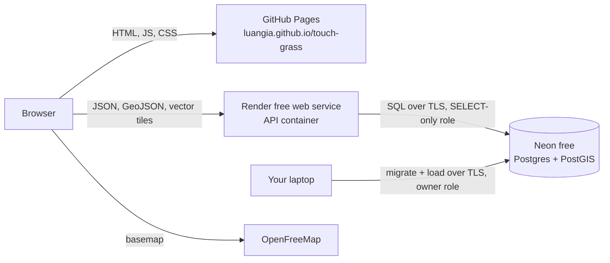

# Deployment

How TouchGrass is deployed, how to redeploy and roll back, and what it costs (D-026).



| Part | Host | Deploys when | Holds state? |
|---|---|---|---|
| Web app | GitHub Pages, built by `.github/workflows/pages.yml` | a push to `main` (once `VITE_API_URL` is set) | No |
| API | Render, from `render.yaml` and `api/Dockerfile` | a push to `main`, after CI passes | No |
| Database | Neon | only when **you** run `touchgrass db migrate` / `load` | **Yes** |

The pipeline never runs in the cloud: it needs ~600 MB of inputs and produces a report you read before loading.

## Costs and limits ($0)

Checked 2026-11-24; free tiers change, so confirm on the providers' pricing pages.

- **Neon Free:** 1 GB of storage per project (the database is ~100 MB). The compute suspends when idle and resumes in under a second.
- **Render Free:** the service sleeps after 15 minutes without traffic; the next visit waits about a minute while it wakes. The web app says so ("Waking the server…") and retries. A paid instance removes the sleep.
- **GitHub Pages:** free for public repositories.

## One-time setup (your steps)

Accounts, passwords and dashboard settings are yours to do; nothing in the repository holds a secret.

### 1. Database (Neon)
1. Create a Neon project: region **AWS US West 2 (Oregon)**, Postgres 17.
2. Copy the connection string for the owner role, choosing the **direct** connection (the host name *without* `-pooler`). Put it in a git-ignored file at the repository root:
   ```bash
   # .env.production  (ignored by git: .env.*)
   DATABASE_URL=postgresql://<owner>:<password>@<host>/<db>?sslmode=require
   ```
3. From `pipeline/`, with that URL in the environment:
   ```bash
   set -a; source ../.env.production; set +a
   uv run touchgrass db status        # shows the PostgreSQL and PostGIS versions
   uv run touchgrass db migrate       # creates PostGIS and the schema
   uv run touchgrass load portland-or # the latest run, in one transaction
   uv run touchgrass db create-reader # the API's SELECT-only role; asks for a new password
   ```
4. Build the API's connection string from the same host and database, with the `touchgrass_reader` role and the password you just chose. Keep it out of the repository; it goes straight into Render (step 2).

### 2. API (Render)
1. In Render: **New → Blueprint**, pick this repository. Render reads `render.yaml`.
2. Enter `DATABASE_URL`: the `touchgrass_reader` string from step 1.4 (direct host, `sslmode=require`).
3. When it's live, open `https://<service>.onrender.com/health`. It should report `"status": "ok"` and schema version 9.

### 3. Web app (GitHub Pages)
1. Repository **Settings → Pages → Source: GitHub Actions**.
2. **Settings → Secrets and variables → Actions → Variables:** add `VITE_API_URL` = the Render URL (no trailing slash).
3. Push to `main` (or run the Pages workflow by hand). The site is at `https://luangia.github.io/touch-grass/`.

### 4. Check the live site
```bash
cd e2e
E2E_BASE_URL=https://luangia.github.io/touch-grass/ npm run test:live
```
The same four smoke paths as CI, against the real site and the real basemap.

## Redeploying

- **Code:** merge to `main`. CI runs; Pages rebuilds; Render redeploys once the checks pass.
- **Data** (a new analysis run): rerun the pipeline locally, read its report, then `touchgrass load portland-or` with the owner URL. Responses are cached by run (the ETag changes with the run id), so browsers fetch the new data straight away.
- **Schema change:** run `touchgrass db migrate` on Neon **before** deploying an API that expects the new version. The API refuses a schema it wasn't written for (`/health` returns 503), so a mismatch is loud and immediate rather than a wrong answer.

## Rolling back

- **API:** Render dashboard → the service → Events → roll back to an earlier deploy.
- **Web app:** rerun the Pages workflow from an earlier commit (Actions → Pages → Run workflow), or revert the commit.
- **Data:** point `data/processed/portland-or/analysis_latest.json` at an earlier run id under `runs/`, then `touchgrass load portland-or` again.

## Safeguards (D-026 Q7)

- The API logs in as `touchgrass_reader`: `SELECT` only, read-only transactions and a 10 s statement timeout, all set on the role, so they hold however it connects. The API also sets them per session (`TOUCHGRASS_SESSION_OPTIONS=0` stops that, for a pooler that rejects startup options).
- CORS allows only `https://luangia.github.io`.
- Secrets live only in Render's dashboard and your git-ignored `.env.production`.
- Error responses carry no internals (a test checks this).
- No rate limiter: the API is read-only, cached and time-limited. Add one only if abuse appears.

## Environment variables

| Variable | Where | Meaning |
|---|---|---|
| `DATABASE_URL` | Render (secret), your `.env.production` | libpq URL; `sslmode=require` |
| `TOUCHGRASS_CORS_ORIGINS` | `render.yaml` | comma-separated allowed origins |
| `TOUCHGRASS_POOL_MIN` / `_MAX` | `render.yaml` | pool size (1 / 3 on the free database) |
| `TOUCHGRASS_SESSION_OPTIONS` | optional | `0` to stop sending session settings at connect time |
| `VITE_API_URL` | GitHub repository variable | the API's public URL, built into the web app |
| `VITE_BASE` | Pages workflow | `/touch-grass/`, the site's sub-path |
