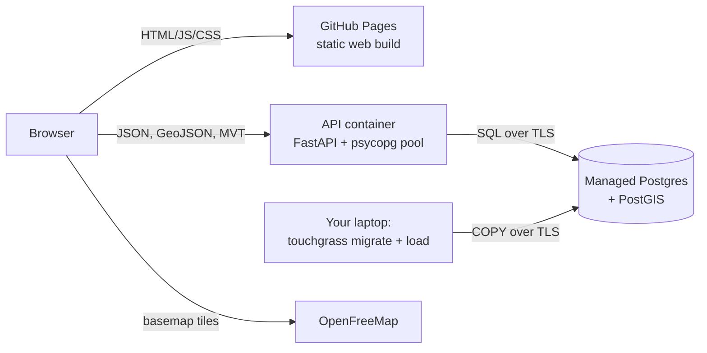
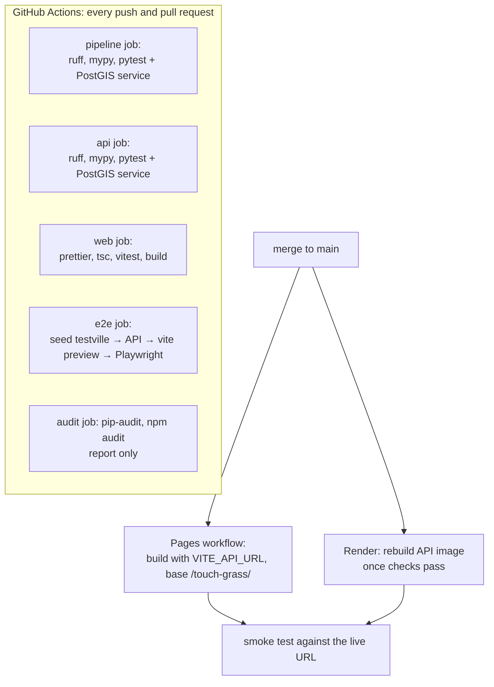

# Stage 11: Testing Hardening, Deployment and Portfolio

> Status: **prepared 2026-11-24, awaiting your approval of Q1–Q8 (§12).** No application code has been changed.
> Hosting facts were checked on 2026-11-24 (sources in §15). Free tiers change often, so §12 Q1 asks for a final check on the providers' own pricing pages before any account is created.

## 1. Objective and expected outcome

At the end of this stage TouchGrass is a **reviewable, reproducible portfolio project**:

| Acceptance criterion (PROJECT_PLAN Stage 11) | What will make it true |
|---|---|
| A fresh clone can reproduce the results by following the README | A tested quickstart, plus a committed **reference file** (source checksums, run id, headline figures) that a fresh run is compared against |
| CI is green | GitHub Actions runs lint, type checks and tests for all three projects (pipeline, api, web) on every push and pull request, with a real PostGIS service |
| (If deployed) the public URL works | The web app on GitHub Pages, the API in a container, the database on managed PostGIS. Plus a browser smoke test against the live URL |

Also part of this stage: an end-to-end smoke test in a real browser, a few production safeguards (§5.5), and the final README (screenshots, architecture diagram, results, credits).

## 2. Why this stage exists

So far everything runs on one laptop, verified by tests that only that laptop runs. A reviewer, whether a hiring manager or a planner, will do one of two things:
- **click a link**, which needs a deployment;
- **read the repository**, where CI status and the README are the first evidence of quality.

"It works on my machine" isn't evidence. This stage turns three private facts into public ones:
- *the tests pass* (CI);
- *the numbers are reproducible* (the reference file and a fresh-clone rehearsal);
- *the app works* (the URL).

It also closes a loose end from Stage 10. The loaded metrics were computed before the Stage 10 commit, so their provenance record says "uncommitted code". The fresh-clone rehearsal (Q6) recomputes everything from committed code.

## 3. Dependencies

- **Everything from Stages 1–10.** Stage 10 is committed as `698066d`; `main` matches `origin/main`, and the repository is public.
- **Tests already in place:**
  - the pipeline's synthetic region (`testville-zz`);
  - the API suite's end-to-end seed (process → network → analyze → metrics → load → HTTP; `api/tests/conftest.py`);
  - the web contract test, which is skipped unless an API is running.
- **Configuration already in place:**
  - the API reads `DATABASE_URL` and `TOUCHGRASS_CORS_ORIGINS`;
  - the web app reads `VITE_API_URL` at build time;
  - both pin dependencies (D-014 `exclude-newer`; `.npmrc before=`).
- **Things only you can do** (§11): create the hosting accounts, enter secrets in the hosts' dashboards, enable GitHub Pages, and push. I can't create accounts or handle credentials, and every push needs your OK.

## 4. Where things stand (checked 2026-11-24)

| Fact | Value | Why it matters |
|---|---|---|
| Database size | **99 MB** (largest tables: `block_access` 19 MB, `census_blocks` 14 MB) | Fits a free managed Postgres tier comfortably |
| Raw downloads | 595 MB, git-ignored | Too big for CI; the `-m data` tests stay local |
| Tests | pipeline 247 (44 s), API 39 (12 s), web 45 passed + 2 skipped (the live-API contract test) | CI needs about 1–2 minutes of test time per push |
| Live (unversioned) sources | 3 City of Portland ArcGIS layers and Metro's ORCA layer | A fresh fetch can return different bytes than ours; see §5.3 |
| Dated sources | OSM `oregon-261101`, TIGER/ACS by vintage | Stable bytes |
| API safeguards already present | read-only transactions; 10 s `statement_timeout`; ETag; `Cache-Control: public, max-age`; CORS allow-list | Only a few gaps remain (§5.5) |
| Web routing | `pageFromPath` matches `^/(rankings\|compare\|about)` | **Breaks under a sub-path**: GitHub Pages serves this app at `/touch-grass/` (§5.4) |
| API connection options | sent as the libpq startup parameter `options=-c ...` | Some connection poolers reject startup `options` (§5.2) |

## 5. Concepts

### 5.1 Continuous integration
CI is a clean machine that runs your checks on every change. That makes "it passes" a fact anyone can see, not a claim. In GitHub Actions:
- a **workflow** (YAML in `.github/workflows/`) contains **jobs**;
- jobs run in parallel on fresh virtual machines (**runners**);
- each job is a list of **steps**.

Three ideas matter here:
- **Service containers.** A job can start `postgis/postgis:17-3.6` next to it. GitHub's runners are amd64 machines, so the image runs natively there, without the emulation it needs on your Mac (D-013). This means the `-m db` tests really run in CI and aren't skipped.
- **Determinism.** CI installs from the lockfiles (`uv sync --frozen`, `npm ci`). The D-014 cutoff dates keep versions fixed, so CI tests the exact versions you developed with.
- **Caching.** The uv and npm caches are keyed by lockfile hash, so a push that doesn't change dependencies skips most of the download.

Running the same commands in CI as locally is the whole point. CI should call `uv run pytest`, `npm test` and the rest, not a parallel set of special commands.

### 5.2 Stateful vs static deployment
TouchGrass has three parts with different deployment needs:

- **The web build is static:** files on a CDN, free, can't break at runtime.
- **The API is stateless compute:** it holds no data itself, so it can be restarted, scaled to zero, or redeployed freely.
- **The database is the only stateful part:** it holds the analysis, and it's loaded from your laptop exactly as today (`touchgrass db migrate` then `touchgrass load`, with `DATABASE_URL` pointing at the managed host). The pipeline never runs in the cloud: it needs 595 MB of inputs and is run deliberately.

**Free tiers trade money for latency.** Free compute *sleeps* when idle:
- a sleeping Render service takes about a minute to wake;
- a suspended Neon database resumes in well under a second.

So the first visitor after a quiet spell waits. The honest fix is in the UI: when `/health` is slow, say *"Waking the server: free hosting sleeps when idle, this can take up to a minute."* The alternative is a few dollars a month for an always-on instance (Q1 B).

**Connection poolers.** Managed Postgres often offers a pooled endpoint (PgBouncer in *transaction* mode) as well as a direct one. In transaction mode, session state doesn't survive between transactions. Some poolers also reject the libpq startup `options` parameter, which is exactly how the API sets `default_transaction_read_only` and `statement_timeout`. Two consequences:
- prepared statements may need disabling (in psycopg, `prepare_threshold=None`);
- per-session settings are lost.

The API holds a pool of at most a few connections, so the **direct endpoint** is simpler and correct here. Q2 recommends it, and recommends putting the safeguards on the database role itself (`ALTER ROLE ... SET ...`), where they hold however the API connects.

### 5.3 Reproducibility, in two tiers
"Reproduce the results" means two different things:

| Tier | Claim | How it's checked |
|---|---|---|
| **Same inputs → same outputs** | Given identical raw files, the pipeline gives identical results | Run ids are content hashes (D-021). The same raw files and code give the **same run id**. Checked by rerunning from a fresh clone against the same downloads |
| **Fresh fetch → same outputs** | Today's downloads equal ours | True for dated sources (OSM snapshot, TIGER/ACS vintages). **Not guaranteed** for the four live ArcGIS layers, which the City and Metro can edit at any time |

The tool for both tiers is a committed **reference file**, `results/portland-or/reference.json`, holding:
- each source's checksum (from the fetch manifests);
- the run ids;
- the headline figures (85.0% within 10 minutes, 97,753 underserved residents, and so on).

A fresh run is compared against it:
- If the checksums match, the figures must match exactly.
- If a live layer's checksum differs, the comparison says **which** source changed, so the different numbers are explained and not a mystery.

Committing checksums and figures is fine. Redistributing the raw files is a separate licence question: OSM's ODbL allows it with attribution and share-alike, but the RLIS licence and the City's Data Distribution Policy would need checking. This plan doesn't redistribute raw data.

### 5.4 Single-page apps on static hosts
The app uses real paths (`/rankings`, `/compare?areas=…`). A static host looks for a *file* at each path. Visiting `/touch-grass/rankings` directly finds none, and the host returns 404. Two standard fixes:
1. **404 fallback:** copy `index.html` to `404.html`. GitHub Pages serves it for unknown paths, the app boots, and it reads `location.pathname`. Links keep their real paths. One downside: the HTTP status code is 404, which only matters for search crawlers.
2. **Hash routing** (`/#/rankings`): always works, but changes every URL.

Under a sub-path, the router must also strip a **base path**. Vite exposes it as `import.meta.env.BASE_URL`. Today `pageFromPath` would treat `/touch-grass/rankings` as the map. The test for that is easy to write first.

### 5.5 Production safeguards for a read-only API
What a public, read-only geospatial API needs, and what TouchGrass already has:

| Risk | Safeguard | Status |
|---|---|---|
| Writes through a bug | Read-only transactions | ✅ session option |
| | A **SELECT-only database role** (defense in depth: even a non-read-only session can't write) | ➕ Q7 |
| Runaway queries (huge bbox, deep zoom) | `statement_timeout` 10 s | ✅ |
| | Parameter validation (zoom 12–14, `MAX_COMPARE`, enums) | ✅ |
| | The timeout set on the role, so it holds behind any pooler | ➕ Q7 |
| Repeated heavy requests (tiles) | ETag + `Cache-Control` so browsers reuse responses | ✅ |
| | A per-IP rate limiter | Not planned (§13) |
| Secrets in the repository | `.env` git-ignored | ✅ |
| | Production secrets only in the host's dashboard and in GitHub Actions secrets | ➕ |
| Leaking internals in errors | FastAPI's default 500 page shows no stack trace | ✅ (a test asserts it) |
| Cross-origin abuse | CORS allow-list: production allows only the Pages origin | ➕ config |
| Dependency vulnerabilities | `pip-audit` and `npm audit --omit=dev` | ➕ Q4, a CI job that reports but doesn't fail the build |

### 5.6 End-to-end tests
Unit tests check pieces; the API suite already checks pipeline → database → HTTP on the synthetic region. What no test checks yet is **the browser**: that the built app, talking to a real API, actually draws a map, a ranking and a comparison. A browser smoke test drives a headless Chromium (Playwright) through a few user paths and fails if any breaks. Keep it to a handful of assertions: smoke tests catch "the page is blank", not styling.

Headless Chromium renders WebGL in software (SwiftShader), which is enough for MapLibre to load. The test waits for the map's `load` event and checks that the source data arrived, not for pixels.

## 6. How the pieces relate

- The synthetic region feeds three test layers: pipeline unit tests, API end-to-end tests, and the browser smoke test.
- The reference file links the real Portland run to the README's figures.
- The deployment is the same code and the same migrations; only the database location differs.

## 7. Implementation approach

1. **CI first:** `.github/workflows/ci.yml` with the pipeline, api and web jobs. Fix anything only a clean machine reveals, such as absolute paths, an ignored file a test relies on, or the PostGIS version.
2. **Reproducibility:**
   - `touchgrass reference portland-or` writes `reference.json` from the current run;
   - a `-m data` test compares a fresh run against it;
   - a **fresh-clone rehearsal** in the scratch area (`git clone`, then follow the README literally, into a separate `DATABASE_URL`), with every README correction it needs. This rehearsal also recomputes the metrics on committed code.
3. **Base path:** `pageFromPath` and `pathFor` honour `BASE_URL`, tests first, plus `404.html` at build time.
4. **API production readiness:**
   - a `Dockerfile` (multi-stage; uv; non-root user; `uvicorn` on `$PORT`);
   - a SQL script for the SELECT-only role and its settings;
   - a "waking the server" state in the web app when `/health` is slow.
5. **Browser smoke test** (Playwright, chromium only) in its own CI job, seeded with `testville-zz`.
6. **Deploy** (§11 has your steps): create the database, migrate and load from your laptop, deploy the API, enable Pages, set the variables, then run the smoke test against the public URL.
7. **Portfolio README:**
   - the problem and headline results;
   - screenshots at desktop and phone width, in light and dark;
   - the architecture diagram;
   - the live link and quickstart;
   - methodology, data licences and attribution;
   - the CI badge;
   - credits (your name, linked to luangia.github.io).

   Then update the resume bullets in CURRENT_STATUS, ticking only those that are now true.

## 8. Expected files

| File | Purpose |
|---|---|
| `.github/workflows/ci.yml` | lint, types, tests (3 projects), e2e, audit |
| `.github/workflows/pages.yml` | build and publish the web app on `main` |
| `api/Dockerfile`, `api/.dockerignore` | API image |
| `sql/roles/api_reader.sql` | SELECT-only role plus `statement_timeout` and `default_transaction_read_only` on the role |
| `pipeline/src/touchgrass/pipeline/reference.py` + CLI `reference` | write and compare `reference.json` |
| `results/portland-or/reference.json` | committed checksums, run ids, headline figures |
| `web/src/state/url.ts` (edit), `web/vite.config.ts` (base, 404 copy) | sub-path routing |
| `web/src/components/WakeNotice.tsx` (or inside `App.tsx`) | cold-start message |
| `e2e/` (Playwright config, `smoke.spec.ts`, seed script) | browser smoke test |
| `README.md`, `docs/screenshots/*.png` | portfolio README |
| `docs/DEPLOYMENT.md` | how it's deployed, how to redeploy, how to roll back, costs |
| docs: D-026, this lesson's §13–16, CURRENT_STATUS, PROJECT_PLAN, IMPLEMENTATION_LOG | as every stage |

## 9. Testing and acceptance

| Check | Pass when |
|---|---|
| CI | All jobs green on `main` and on a test pull request; db tests *run* (not skipped) in CI |
| Fresh clone | Following the README in an empty directory gives a run whose checksums and run ids match `reference.json` (same raw files), or whose differences are reported per source (fresh fetch) |
| Sub-path routing | Unit tests for `/touch-grass/rankings` etc.; a deep link to `/touch-grass/compare?areas=…` works on Pages |
| Read-only role | A test connecting as the reader role gets an error on `INSERT`; a query over the timeout is cancelled |
| Browser smoke test | Map loads with data; Rankings shows four lists; Compare with two areas shows the table; About lists the licences. Passes in CI against `testville-zz` and once against the public URL |
| Cold start | With the API asleep, the page shows the wake notice, then the data, with no error state |
| Live URL | The map, Rankings, Compare and About work at desktop and phone widths; `/health` reports the schema version and run id |
| README | A reader can answer "what, why, how well, how to run" without opening another file |

## 10. Proposed implementation checklist

- [ ] CI workflow (pipeline, api, web jobs + PostGIS service); green on a branch
- [ ] Audit job (report only)
- [ ] Reference file writer + comparison test; commit `reference.json`
- [ ] Fresh-clone rehearsal in the scratch area; fix the README until it works verbatim; rerun metrics on committed code
- [ ] Base-path routing + `404.html` (tests first)
- [ ] API `Dockerfile`; reader-role SQL + test; wake notice in the web app
- [ ] Playwright smoke test + CI job
- [ ] **Your steps (§11):** accounts, secrets, Pages, push. Then I migrate, load and verify
- [ ] Smoke test against the live URL; desktop + phone check in the browser
- [ ] Portfolio README, screenshots, `DEPLOYMENT.md`; D-026; docs; resume bullets (only true ones)

## 11. What only you can do (and when)

I'll stop and ask at each of these. Nothing here happens without you.

1. **Push** the branch and open the pull request where CI first runs. I'll ask before every push. This environment has no SSH key for GitHub, so you may need to run the push yourself.
2. **Create the accounts** (for example Neon and Render, if Q1 A is chosen) and copy the database connection string into a local, git-ignored `.env.production`. I never type passwords or keys.
3. **Set the host settings:**
   - in Render, `DATABASE_URL` for the reader role and `TOUCHGRASS_CORS_ORIGINS=https://luangia.github.io`;
   - in GitHub, `VITE_API_URL` as a repository variable;
   - enable Pages ("GitHub Actions" as the source).
4. **Approve the production load:** `migrate` and `load` against the managed database.

## 12. Decisions to approve (D-026)

| # | Question | Recommendation | Alternatives |
|---|---|---|---|
| Q1 | Where to deploy? | **A. $0:** web on **GitHub Pages**; API as a Docker web service on **Render free** (sleeps after 15 min, about a minute to wake); database on **Neon free** (1 GB per project, PostGIS included; ours is 99 MB). A wake notice in the UI. You confirm the free terms on the providers' pricing pages before signing up | **B.** The same with an always-on paid Render instance (third-party guides say about $7 a month; unconfirmed). **C.** Static snapshot only: pre-rendered JSON and tiles on Pages, no live API (always fast and free, but the backend isn't shown and the client needs rework). **D.** No deployment: local demo, screenshots and a short screen recording (the plan's first deferral) |
| Q2 | How does production get its data? | From your laptop: `touchgrass db migrate` + `load` with `DATABASE_URL` set to Neon's **direct (unpooled)** endpoint, TLS required. The API also uses the direct endpoint, with a small pool (max 3). First check Neon's PostGIS version runs our migrations and `ST_AsMVT` queries; the test suite against it decides | Pooled endpoint with `prepare_threshold=None` and role-level settings. A CI job that loads production (needs raw data in CI; no) |
| Q3 | Web hosting details | Pages built by an Actions workflow; Vite `base: "/touch-grass/"`; router strips `BASE_URL`; `404.html` fallback for deep links; `VITE_API_URL` from a repository variable | Hash routing (`/#/rankings`). A custom domain (later, if you want one) |
| Q4 | CI scope | Jobs for pipeline, api, web, each running the same commands as locally; PostGIS service so db tests run; `-m data` stays local (needs 595 MB); uv and npm caches; on push to `main` and on pull requests. Plus an audit job that **reports** (`pip-audit`, `npm audit --omit=dev`) without failing the build | Blocking audit (fails on any advisory, including unfixable ones). Matrix over Python versions (we pin one; not needed) |
| Q5 | End-to-end test | A **Playwright** smoke test (chromium only, about 4 paths) against `testville-zz`, seeded by reusing the API suite's seed code, in CI; run once more against the public URL after deploy | No browser test: run the existing contract test in CI against a seeded API (cheaper; doesn't catch a blank page) |
| Q6 | Reproducibility | Commit `results/portland-or/reference.json` (source checksums, run ids, headline figures); `touchgrass reference` writes and compares it; a fresh-clone rehearsal fixes the README until it works verbatim. Live ArcGIS layers are reported per source when they drift. Raw data isn't redistributed | Publish a raw-data snapshot (licence check needed for RLIS and City data). No reference file, only the README |
| Q7 | Hardening | A SELECT-only `touchgrass_reader` role with `statement_timeout` and read-only transactions set **on the role**; production CORS allows only the Pages origin; secrets only in host and GitHub settings; a test that 500s don't leak internals. **No** rate limiter | An in-app rate limiter (for example slowapi) or a CDN in front of the API, worth it only if abuse shows up |
| Q8 | Portfolio scope in this stage | Final README (results, screenshots in light and dark at desktop and phone widths, architecture diagram, live link, quickstart, licences and attribution, CI badge, credits to Luan Pham → luangia.github.io) and `DEPLOYMENT.md`. The longer write-up (case study, interview notes) comes from `/learn:portfolio` afterwards | Do the `/learn:portfolio` material in this stage too |

## 13. Not planned (and why)

- **A per-IP rate limiter:** read-only, cached, timed-out queries on a free single instance; add it only if abuse appears.
- **Running the pipeline in the cloud:** it needs 595 MB of inputs and is run deliberately, with a report you read.
- **A second region:** a non-goal (PROJECT_PLAN §3). The synthetic `testville-zz` region and `test_no_region_hardcoding` already show the code doesn't assume Portland. The resume bullet about region onboarding should say exactly that, and no more.
- **Monitoring and alerting beyond the host's logs:** a portfolio demo, not a service with users who depend on it.

## 14. Risks

| Risk | Mitigation |
|---|---|
| Free terms change, or a provider asks for a card | Q1 asks you to confirm before signing up; B/C/D remain |
| Neon's PostGIS version differs from local 3.6 | Run the migrations and the API test suite against it before loading; our SQL needs PostGIS ≥ 3.0 (`ST_TileEnvelope`) |
| A fresh fetch gives different live layers | Expected; the reference comparison names the source. Our numbers stay tied to our checksums |
| Headless WebGL is flaky in CI | The smoke test waits on the map's `load` event and data, not pixels; a retry of 1 |
| Cold start makes a reviewer think it's broken | Wake notice; the README says so; Q1 B removes it |

## 15. Sources (checked 2026-11-24)

- Neon Free plan, 1 GB per project: [changelog 2026-10-02](https://neon.com/docs/changelog/2026-10-02), [free-plan limits](https://neon.com/faqs/free-plan-limits-and-quotas), [pricing](https://neon.com/pricing), [plans](https://neon.com/docs/introduction/limits). PostGIS is on all plans.
- Render free web services: spin down after 15 minutes idle, about a minute to wake, 750 free instance hours a month, ephemeral filesystem ([Deploy for Free](https://render.com/docs/free), [FAQ](https://render.com/docs/faq), [Docker](https://render.com/hosting/docker)). Paid prices weren't confirmed on Render's own pricing page; check [render.com/pricing](https://render.com/pricing).
